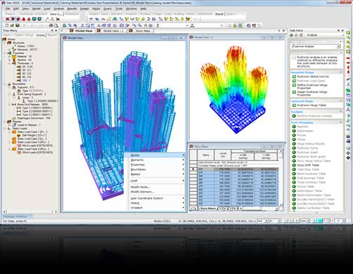
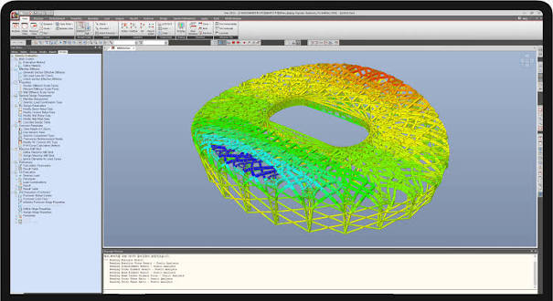

# MIDAS Gen Building Analysis With Reviewable Results

A building model can finish its calculation while the governing response remains difficult to explain.
MIDAS Gen combines structural analysis and member design for buildings and general structures.
Organise the study around the response being assessed, the assumptions that produce it, and the evidence retained for review.

## Choose the analysis from the response you need

Keep the engineering question attached to each analysis case.
A displacement plot, a buckling factor, and a nonlinear response history describe different aspects of structural behaviour.

| Question under review | Analysis capability | Inputs to identify | Results to retain |
|---|---|---|---|
| How does gravity loading deform the structure? | Static analysis | Stiffness, restraints, and loading | Reactions, displacements, and member forces |
| Does deformation influence equilibrium? | P-Delta analysis | Relevant loading and geometric assumptions | Response changes relative to the reference case |
| How does the building respond dynamically? | Modal and dynamic analysis | Mass, stiffness, excitation, and damping | Modes and the selected response quantities |
| What changes during construction? | Construction stage analysis | Activation sequence and time-dependent properties | Stage-specific forces and deformation |
| How does response develop beyond yielding? | Pushover or nonlinear time history | Nonlinear properties and loading definition | Response curves and analysis status |

MIDAS Gen software also supports design workflows for steel, reinforced concrete, and composite structural members.
Keep the analysis assumptions and the selected design standard visible when presenting a design result.

For a comparison environment, [KratosEigen.cmake](cmake_modules/KratosEigen.cmake) configures Eigen discovery.
[KratosBoost.cmake](cmake_modules/KratosBoost.cmake) locates Boost headers and libraries.

[](https://midas-gen.github.io/MIDAS-Gen/)

## Preserve the sequence behind the response

### Construction stages carry a history

Construction stage analysis may involve changes in geometry, supports, loading, and material properties.
A final-stage model alone does not describe how those conditions developed.

Record the sequence of activation and the time information used for the analysis.
For concrete structures, identify the creep, shrinkage, and strength-development assumptions where they are relevant.

Review the following together:

- Which members and boundaries are active at each stage.
- When loads are introduced or removed.
- Which material properties vary with time.
- Which stage supplies the reported displacement or force.
- Whether the comparison uses the same reference state.

The companion [KratosDependencies.cmake](cmake_modules/KratosDependencies.cmake) manages application dependencies.
[standard_configure.bat](scripts/standard_configure.bat) records a Windows build configuration procedure.

### Dynamic cases need identifiable inputs

For seismic studies, distinguish response-spectrum analysis from time-history analysis.
Keep the excitation definition, damping assumptions, mass representation, and reported direction with the case.

MIDAS Gen includes pushover and inelastic time-history capabilities.
Record the nonlinear properties and analysis controls used to obtain the response.

A peak value should remain traceable to its case, direction, and result type.
Do not mix values from incompatible stages or independent envelopes when assembling a comparison.



## Trace the numerical model back to physical assumptions

### Geometry, connectivity, and discretisation

Check that node locations, member connectivity, supports, and releases represent the intended structural system.
An unintended gap or release can affect the response before any design calculation begins.

For plates, walls, and solid regions, compare the quantities of interest as discretisation changes.
A local peak and an integrated structural response may show different sensitivity to the mesh.

The supplied mesh-library discovery references cover several tools:

- [FindMMG2D.cmake](cmake_modules/FindMMG2D.cmake): MMG2D discovery.
- [FindMMG3D.cmake](cmake_modules/FindMMG3D.cmake): MMG3D discovery.
- [FindMMGS.cmake](cmake_modules/FindMMGS.cmake): MMGS discovery.
- [FindMMG.cmake](cmake_modules/FindMMG.cmake): MMG discovery configuration.
- [FindTetgen.cmake](cmake_modules/FindTetgen.cmake): TetGen headers and library discovery.

For an API-based model-generation worksheet, the following JSON illustrates the documented node assignment structure.
Node 501 is placed at the origin; coordinate values use the model's active length units.

```json
{
  "Assign": {
    "501": {
      "X": 0.0,
      "Y": 0.0,
      "Z": 0.0
    }
  }
}
```

Check the existing node identifiers and unit system before adapting an assignment for a real project.
An isolated node definition still needs elements and appropriate model data to form a structural system.

### Numerical configuration is part of a comparison

Record the solver and analysis settings when comparing calculations.
Differences in model assumptions should be separated from changes in the numerical environment.

The companion sparse-solver discovery modules are [FindUMFPACK.cmake](cmake_modules/FindUMFPACK.cmake), [FindSPQR.cmake](cmake_modules/FindSPQR.cmake), and [FindCHOLMOD.cmake](cmake_modules/FindCHOLMOD.cmake).
[FindTRILINOS.cmake](cmake_modules/FindTRILINOS.cmake) handles Trilinos discovery, while [FindTBB.cmake](cmake_modules/FindTBB.cmake) locates the TBB threading library.

For partitioning and ordering dependencies, see [FindMETIS.cmake](cmake_modules/FindMETIS.cmake) and [FindScotch.cmake](cmake_modules/FindScotch.cmake).
These configuration references help identify the dependencies recorded for a separate numerical environment.

## Query GEN NX model data before automating changes

MIDAS GEN NX exposes a REST API for document operations, model databases, analysis, and results.
Use the API documentation corresponding to the installed product and release.

An initial automation task can query existing nodes and compare them with the model visible in the interface.
Prepare the product-provided GEN API base URL and API key in the named environment variables.
GEN NX must be running and connected to its API service.

```powershell
$headers = @{ "MAPI-Key" = $env:MIDAS_MAPI_KEY }
$baseUrl = $env:MIDAS_GEN_BASE_URL.TrimEnd("/")
$response = Invoke-RestMethod -Method Get -Uri "$baseUrl/db/NODE" -Headers $headers
$response.NODE.PSObject.Properties | Select-Object Name, Value
```

The GET request reads the node database.
Check the response and selected project before extending a script to create or modify model entities.

The official midas-gen Python library provides another route to GEN NX automation.
Match its documentation and available functions to the release being used.

The companion Python integration references are [pybind11Tools.cmake](cmake_modules/pybind11Tools.cmake) and [FindPythonLibsNew.cmake](cmake_modules/FindPythonLibsNew.cmake).
[stub_generation.py](scripts/post_install/stub_generation.py) concerns Python stub generation, while [pyproject.toml](scripts/wheels/pyproject.toml) describes unified Kratos package metadata.

Keep a record of the API operation, affected entity identifiers, and model revision.
After a model-generation change, inspect connectivity and assignments before relying on the next analysis result.

## Report deformation with its definition and units

A displacement at one floor is different from the relative movement between adjacent levels.
State the result definition rather than using a short label without context.

For a simple paired-level worksheet, relative displacement divided by storey height gives a dimensionless ratio.
Use simultaneous signed displacements from the same case and step; independently enveloped floor peaks do not supply such a pair.

Prepare a CSV with Story, Lower_mm, Upper_mm, and Height_mm columns.
This Python example calculates the magnitude of that ratio for each prepared row:

```python
import csv

with open("paired-level-displacements.csv", newline="", encoding="utf-8-sig") as source:
    for row in csv.DictReader(source):
        height = float(row["Height_mm"])
        if height <= 0:
            raise ValueError("Storey height must be positive.")
        relative = float(row["Upper_mm"]) - float(row["Lower_mm"])
        print(f'{row["Story"]}: relative displacement/height = {abs(relative) / height:.6f}')
```

This worksheet does not apply a design-code limit or replace the product's code-specific reporting procedure.
Keep the case identifier, direction, and extraction convention with the numerical data.



For member design, retain the governing combination, section, material, design parameters, and calculation details.
A later section change should trigger a review of the associated analysis and design results.

## Make the calculation reproducible across revisions

Save the model with the load definitions, stage information, analysis controls, and exported results used for the report.
Record the product release and the design standard selected in the project.

Before comparing two revisions, identify whether changes affect:

1. Geometry, connectivity, or boundary conditions.
2. Section properties, materials, or stiffness assumptions.
3. Loads, masses, combinations, or construction history.
4. Analysis settings or nonlinear properties.
5. The location, direction, or definition of the reported result.

Keep the original result tables available alongside presentation plots.
For material labelled midas gen nx 2026 or midas gen 2026, verify the release-specific instructions and available features against the installed version.

## Related Search Terms

midas gen, midas gen nx, midas gen software, midas gen nx 2026, midas gen 2026, structural-analysis, structural-engineering, finite-element-analysis, finite-elements, modal-analysis, reinforced-concrete, pdelta-effects, numerical-methods, python, automation
